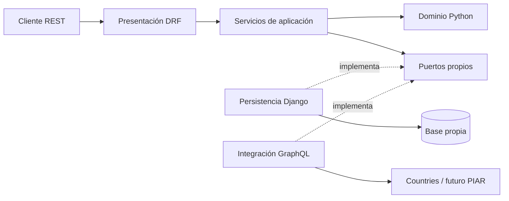

# Arquitectura de GoCargo

## Propósito y alcance

Demo logística para validar una estructura Django antes del módulo institucional de visitas pedagógicas. Gestiona sucursales y envíos internacionales y consume Countries GraphQL. PIAR 3.0 será un proveedor externo de lectura del módulo real; no se modifica ni se importa su código.

El backend es un monolito modular. Cada módulo separa dominio, aplicación, infraestructura y presentación, conservando DDD, arquitectura limpia/hexagonal, Repository, DRY y SOLID.

## Estructura implementada

```text
apps/
  branches/
    domain/
      entities.py                 Branch e invariantes
      exceptions.py               errores de dominio
    application/
      dto.py                      mensajes de entrada/salida
      ports.py                    contrato del repositorio
      services.py                 acciones de sucursales
      exceptions.py               errores de coordinación
    infrastructure/
      persistence/
        models.py                 BranchModel
        repositories.py           DjangoBranchRepository
    presentation/
      serializers.py
      views.py
      urls.py
    models.py                     descubrimiento Django
    apps.py
    migrations/
    tests/
  shipments/
    domain/
      entities.py                 Shipment
      value_objects.py            PackageWeight
      exceptions.py
    application/                  DTO, puertos, servicio y errores
    infrastructure/
      persistence/                models.py, repositories.py
      integrations/
        branches.py               adaptación del servicio de sucursales
        countries/
          client.py               HTTP y envelope GraphQL
          queries.py              consulta parametrizada
          mappers.py              traducción del país externo
          catalog.py              implementación de ICountryCatalog
    presentation/                 serializers.py, views.py, urls.py
    models.py
    apps.py
    migrations/
    tests/
```

Se omiten inicializadores. No se crean carpetas vacías para funcionalidades futuras.

## Motivo de la reorganización

La versión anterior agrupaba el pequeño dominio en domain.py y algunos adaptadores en archivos compartidos para reducir fragmentación. Podía mantener las dependencias correctas, pero hacía menos visible la separación buscada en este ejemplo. Ahora el dominio es un paquete y la infraestructura distingue persistencia, integración entre módulos y consumo GraphQL. Persistencia separa modelos y repositorios. La conversión se centraliza en AutoModelMapper, compartido por BaseRepository, en lugar de una clase por entidad.

No se añaden nuevas capas de ejecución. Se mantienen agrupados los DTO y puertos relacionados y un servicio por módulo para evitar una clase y una interfaz por cada acción. Los DTO siguen la nomenclatura ModeloDto, ModeloDtoCreate y ModeloDtoUpdate; los adicionales usan ModeloDtoSufijo.

## Dependencias

| Responsabilidad | Puede conocer | Debe evitar |
| --- | --- | --- |
| Dominio | Biblioteca estándar y su propio modelo | Django, DRF, red, settings y adaptadores |
| Aplicación | Dominio, DTO y puertos propios | ORM, requests, infraestructura y presentación |
| Persistencia | Puertos, dominio y ORM | Vistas y reglas HTTP |
| Integraciones | Contratos del consumidor y transporte | Detalles del frontend |
| Presentación | Servicios, DTO, DRF y composición | ORM y consultas remotas directas |
| Composición | Implementaciones necesarias | Reglas del negocio |



El diagrama expresa interacciones. En código, los adaptadores dependen de los contratos del núcleo. config/dependencies.py construye las implementaciones y las entrega a los servicios.

## Decisiones técnicas

**Dominio puro:** entidades y objeto de valor son dataclasses inmutables. Sus invariantes se prueban sin inicializar Django.

**Repository:** los contratos devuelven entidades propias. QuerySet y modelos ORM permanecen en persistencia. La base compartida implementa create, get_all, get_by_id, update, delete e is_exist, sin alias duplicados. Los repositorios específicos añaden únicamente consultas propias del negocio.

**Mapeo con biblioteca:** py-automapper resuelve los campos coincidentes entre entidad, ORM y DTO. BaseRepository configura la conversión automática al recibir el modelo y el tipo de entidad. Solo las diferencias como PackageWeight ↔ weight_kg se declaran mediante model_fields/domain_fields en el repositorio correspondiente. djangorestframework-dataclasses genera serializers desde los DTO. Las representaciones siguen separadas por responsabilidad.

**Transacciones nativas:** aplicación recibe AbstractContextManager de Python; composición proporciona transaction.atomic(). No se mantiene un UnitOfWork propio ni se importa Django desde el núcleo.

**Presentación acotada:** APIView expone únicamente las acciones actuales. Las escrituras pasan por servicios. No se heredan acciones CRUD adicionales.

**GraphQL de salida:** cliente, consulta, mapper y catálogo se separan por función. El cliente comprueba HTTP/JSON/errores GraphQL; el mapper traduce datos imprescindibles y el catálogo satisface el puerto.

**OpenAPI generado:** drf-spectacular genera el contrato desde DRF; Scalar lo presenta. No se conserva un JSON manual paralelo.

**DRY y SOLID:** contratos estructurales pequeños con Protocol, campos HTTP compartidos y persistencia CRUD compartida. No se reimplementan transacciones ni HTTP, ni se exige una interfaz por clase.

## Datos y límites

El envío guarda referencias y snapshots de sucursal y país. Listado y detalle históricos usan solo la base local. Ante indisponibilidad del proveedor, la creación devuelve 503 sin insertar el envío. No se autoriza usar caché vencida para aprobar operaciones.

La consulta remota ocurre antes de abrir la transacción local. Esta no garantiza vigencia simultánea del dato remoto. La demo tampoco serializa cambios concurrentes de capacidad/inactivación de sucursal; eso requiere revalidación y bloqueos/restricciones probados en el motor final.

Los listados conservan arreglos sin paginación dentro de data. SQLite está destinado a la demo. PostgreSQL y SQL Server exigen drivers compatibles, migraciones, traslado de datos y pruebas de restricciones/concurrencia.

## Evolución prevista

Autenticación propia con Django/Simple JWT y autorización por operación/objeto se documentan, sin implementarlas. La identidad local y la cuenta de consumo PIAR son distintas. El backend debe limitar el alcance local aunque la cuenta institucional tenga más permisos.

PIAR no tiene que cambiar a REST. Una presentación GraphQL futura puede invocar los mismos servicios. Incorporar el módulo dentro de PIAR requerirá alinear versiones, usuarios, permisos, app labels, migraciones y propiedad de datos. No se crean adaptadores institucionales ficticios.

## Referencias

- [Python Protocol](https://docs.python.org/3/library/typing.html#typing.Protocol).
- [Transacciones Django](https://docs.djangoproject.com/en/6.1/topics/db/transactions/).
- [DRF serializers](https://www.django-rest-framework.org/api-guide/serializers/).
- [drf-spectacular](https://drf-spectacular.readthedocs.io/en/latest/readme.html).
